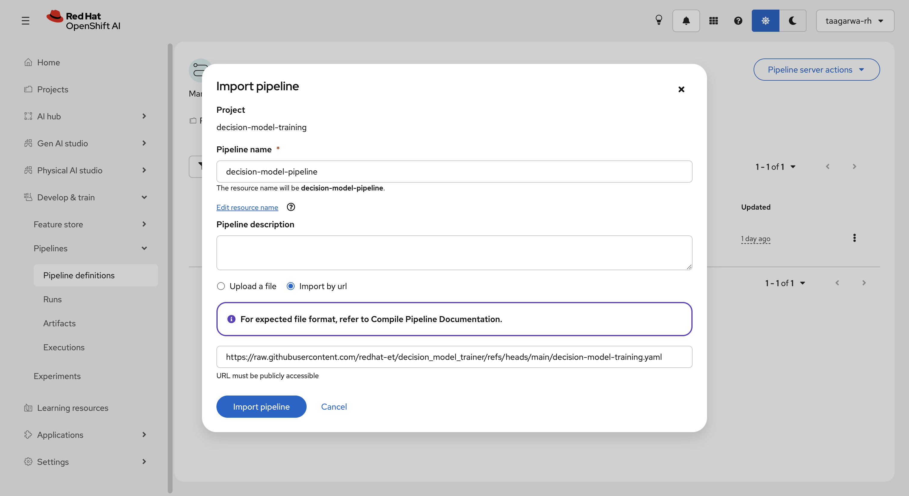

# Decision Model Trainer

Decision Model Trainer is a Kubeflow Pipelines (KFP) component for Red Hat OpenShift AI (RHOAI) that fine-tunes language models to make structured decisions from text. The pipeline accepts a JSON training configuration, runs GPU-backed preparation and training in a container, and publishes adapter and optional merged-model artifacts to the pipeline artifact store. A local CLI provides the same training utility for development and debugging, along with inference and Hugging Face publishing commands.

## Features

- Kubeflow Pipelines v2 decision model training pipeline for RHOAI, with GPU scheduling controls, disabled caching, and separate adapter and merged-model artifacts.
- Accepts local datasets or Hugging Face datasets and configurable dataset splits.
- Supports typed `choice`, `noul`, and `score` questions with structured gold answers.
- Provides reproducible holdout splitting, skipped-record reporting, evaluation, checkpointing, and decision-head calibration.
- Supports configurable base models, sequence length, 4-bit loading, LoRA settings, gradient checkpointing, and standard Transformers training arguments.
- Automatically selects CUDA, Apple MPS, or CPU, with CUDA-oriented settings for RHOAI GPU workloads.
- Provides `train`, `infer`, and `push` CLI commands for local development, validation, and optional merged 16-bit Hub publishing.

## Training Pipeline Overview

The training pipeline finetunes a LORA on an existing LLM for structured decisions. Finetuning follows the process outlined by [Unsloth's Decision Model training Notebook](https://colab.research.google.com/github/unslothai/notebooks/blob/main/nb/Qwen3_5_(4B)-Decision.ipynb):
1. Load the existing, pretrained LLM (e.g. `unsloth/Qwen3.5-4B`)
2. Attach a LORA for finetuning
3. Fetch a training dataset from Huggingface or use a local dataset file and format it for calibrated decisions
4. Split the training data into a train set and a holdout set for calibration
5. Report train/eval accuracy before adding the LoRA (and optional test-split accuracy)
6. Train the LoRA on the train set and report accuracy again
7. Calibrate on the eval set and report final accuracy

### Training Datasets Schema

The pipeline accepts any dataset with the following schema:

- `state`: the input text
- `questions`: a JSON object (or object-valued column) containing `choice`, `noul`, or `score` questions
- `gold/answers`: the expected answers

Public datasets following this format can be found under the ["structured-decisions" tag on HuggingFace](https://huggingface.co/datasets?other=structured-decisions).
For an example, check out the [LocalLLaMA/typed-decisions dataset](https://huggingface.co/datasets/LocalLLaMA/typed-decisions).

If your dataset does not follow this format, it will need to be converted to the required format before use.
You can prepare the dataset ahead of time, or add an adapter to this project in [src/decision_model_trainer/datasets](./src/decision_model_trainer/datasets).
Check out [src/decision_model_trainer/datasets/openai_moderation_dataset.py](./src/decision_model_trainer/datasets/openai_moderation_dataset.py) for an example of how to convert a dataset to the required format.

## Run the Training Pipeline in RHOAI

Import the pipeline [`decision-model-training.yaml`](./decision-model-training.yaml) to the RHOAI Data Science Pipelines server as described in the [RHOAI documentation](https://docs.redhat.com/en/documentation/red_hat_openshift_ai_self-managed/3.4/html/working_with_ai_pipelines/managing-ai-pipelines_ai-pipelines#importing-a-pipeline_ai-pipelines):

1. Copy the content from [`decision-model-training.yaml`](./decision-model-training.yaml) to a local file, e.g. `pipeline.yaml`.
2. Go to the RHOAI dashboard and navigate to "Develop & Train" > "Pipelines" > "Pipeline Definitions".
3. Click "Import pipeline".
4. Name the pipeline (e.g. `decision-model-training`) and upload the pipeline file.
5. Click "Import Pipeline" to import the pipeline.



> [!NOTE]
> The default pipeline definition requests one `nvidia.com/gpu` accelerator and runs on nodes with `gpu-pool-size=large`.
> It also tolerates the `nvidia.com/gpu=true:NoSchedule` taint.
> You can remove these defaults by deleting the items below the `---` in the `decision-model-training.yaml`.
> You can also override them by running the pipeline compilation utility:
> 
> ```bash
> uv run decision-model-trainer-pipeline \
>   --node-selector gpu-pool-size=large \
>   --node-selector accelerator=nvidia \
>   --toleration key=nvidia.com/gpu,operator=Equal,value=true,effect=NoSchedule \
>   --output my-decision-model-training.yaml
> ```

After importing the pipeline, you can create a run.

The pipeline runs take one parameter, `config_json`, the training configuration as a JSON object.
This is where you can specify the training parameters for the run, including the dataset, model, and other parameters.

To create a run, do the following:

1. Create your `config.yaml` for the run by following the [configuration reference](./docs/configuration.md). See [examples/config.yaml](./examples/config.yaml) for an example config.
2. In your new pipeline definition, click on "Actions" > "Create run".
3. Give your run a name and uncheck "Enable MLflow experiment tracking" (this will be added in a later update).
4. Convert your `config.yaml` to JSON using `yq -o=json -I=0 config.yaml`, then copy and paste the resulting JSON into the `config_json` parameter.
5. Click "Create Run".

The pipeline saves the LORA adapter and a merged 16-bit model as separate typed KFP `Model` artifacts to your pipeline server object storage.

See the [training metrics guide](./docs/metrics.md) for an explanation of the printed accuracy and ECE values and how to interpret the stages and splits.

## Deploy the Decision Model

After training your decision model, you can deploy the merged model in OpenShift.

First, create the storage secret:

```sh
cp openshift/decision-model/base/secret.example.yaml openshift/decision-model/base/secret.yaml
```

Set `AWS_ENDPOINT_URL`, `AWS_ACCESS_KEY_ID`, and `AWS_SECRET_ACCESS_KEY` for the S3-compatible storage provider, set `MODEL_S3_URI` to your model path, then apply it to the namespace:

```sh
oc apply -f openshift/decision-model/base/secret.yaml -n <namespace>
```

Then deploy the model:

```sh
oc apply -k openshift/decision-model/overlays/preprod -n <namespace>
```

Once the model is live, test the endpoint:

```sh
MODEL_ROUTE=$(oc get route decision-model-route -o jsonpath='http://{.spec.host}{"\n"}')

curl -s $MODEL_ROUTE/v1/systemone \
  -H "Content-Type: application/json" \
  -d '{
    "model": "decision-model",
    "state": {"ticket": "My card was charged twice for one order."},
    "questions": {
      "team": {
        "type": "choice",
        "instructions": "Which team should handle this ticket?",
        "criteria": {
          "billing": "payments and refunds",
          "shipping": "deliveries",
          "security": "account access"
        }
      },
      "urgent": {
        "type": "noul",
        "instructions": "Does the customer need a reply within the hour?",
        "criteria": {"true": "the account is locked or money is moving"}
      },
      "tone": {
        "type": "score",
        "instructions": "How upset is the customer?",
        "criteria": ["calm", "annoyed", "furious"]
      }
    },
    "chat_template_kwargs": {"enable_thinking": false}
  }'
```

## CLI

The CLI is installable on macOS and Linux. Training can use CUDA, Apple MPS, or CPU according to the configured or automatically detected device. CUDA remains the recommended backend for larger RHOAI runs; use the appropriate PyTorch and Unsloth installation for the host.

```bash
# Any Mac or Linux machine, including Apple Silicon/MPS
uv sync

# NVIDIA machine, after selecting the appropriate PyTorch CUDA index for your system
uv sync --extra cuda
```

Unsloth's official installation guidance should be followed if its CUDA/PyTorch wheel combination differs from the versions in your environment: [https://unsloth.ai/docs/get-started/install](https://unsloth.ai/docs/get-started/install).

### Configuration

Copy `examples/config.yaml` and update the dataset and output paths. See the [configuration reference](docs/configuration.md) for all available options.

```bash
decision-model-trainer train --config examples/config.yaml
```

### Publish to Hugging Face 

Set `HF_TOKEN` or pass `--token`:

```bash
decision-model-trainer push --model outputs/qwen-decision --repo your-user/qwen-decision
decision-model-trainer push --model outputs/qwen-decision --repo your-user/qwen-decision --merge
```

The `--merge` option uploads a merged 16-bit model and may require substantially more disk memory than adapter upload.

### Inference

Run live inference against the trained model using:

```bash
decision-model-trainer infer --model outputs/qwen-decision --state "Refund invoice 4411" --questions examples/questions.json
```

See [`examples/questions.json`](./examples/questions.json) for sample input.

### RHOAI Training Pipeline Compilation

Compile the RHOAI training pipeline YAML file using:

```bash
uv sync
DECISION_MODEL_TRAINER_IMAGE=quay.io/rh_ee_taagarwa/decision-model-trainer:latest \
  uv run decision-model-trainer-pipeline \
  --output my-decision-model-training.yaml
```

Scheduling defaults to `gpu-pool-size=large` and the `nvidia.com/gpu=true:NoSchedule` toleration. Override them at compile time:

```bash
uv run decision-model-trainer-pipeline \
  --node-selector gpu-pool-size=large \
  --node-selector accelerator=nvidia \
  --toleration key=nvidia.com/gpu,operator=Equal,value=true,effect=NoSchedule \
  --output my-decision-model-training.yaml
```

## Utility Scripts

### Downloading object storage data

Use `scripts/download_s3_folder.py` to copy all objects below an S3 prefix to a local directory. Credentials are loaded using the standard boto3 environment, profile, or instance-role mechanisms. The endpoint option works with AWS, MinIO, Ceph, and other S3-compatible services:

```bash
AWS_ACCESS_KEY_ID=... AWS_SECRET_ACCESS_KEY=... \
  uv run python scripts/download_s3_folder.py \
  s3://my-bucket/training-data/ ./downloads/training-data \
  --endpoint-url https://object.example.com --region us-east-1
```

The source prefix is treated as a folder, so `s3://my-bucket/training-data` downloads keys beginning with `training-data/`. Existing local files are overwritten. For a public bucket, add `--no-sign-request`.

## Development

### Releases and container images

The project follows [Semantic Versioning](https://semver.org/). The version in
`pyproject.toml` is the source of truth. Use a patch release for fixes, a minor
release for backwards-compatible features, and a major release for breaking
changes.

Bump and tag the version from the project root, then push the release commit:

```bash
# Choose exactly one bump type: patch, minor, or major
uv version --bump patch
uv lock
VERSION=$(uv version --short)
IMAGE="quay.io/rh_ee_taagarwa/decision-model-trainer:v${VERSION}"

# Regenerate the pipeline with the versioned image reference
DECISION_MODEL_TRAINER_IMAGE="$IMAGE" \
  uv run python -m decision_model_trainer.pipeline \
  --output decision-model-training.yaml

git add pyproject.toml uv.lock decision-model-training.yaml
git commit -m "Release v${VERSION}"
git tag -a "v${VERSION}" -m "Release v${VERSION}"
git push origin main --follow-tags
```

Then build and push the Container image:

```bash
VERSION=$(uv version --short)
IMAGE="quay.io/rh_ee_taagarwa/decision-model-trainer:v${VERSION}"

podman build --no-cache --platform linux/amd64 \
  -f Containerfile \
  -t "$IMAGE" .

podman push "$IMAGE"
```

## Known Issues

- [ ] MLflow logging is bugged in RHOAI. Jobs will not properly log metrics to MLflow when running in RHOAI
